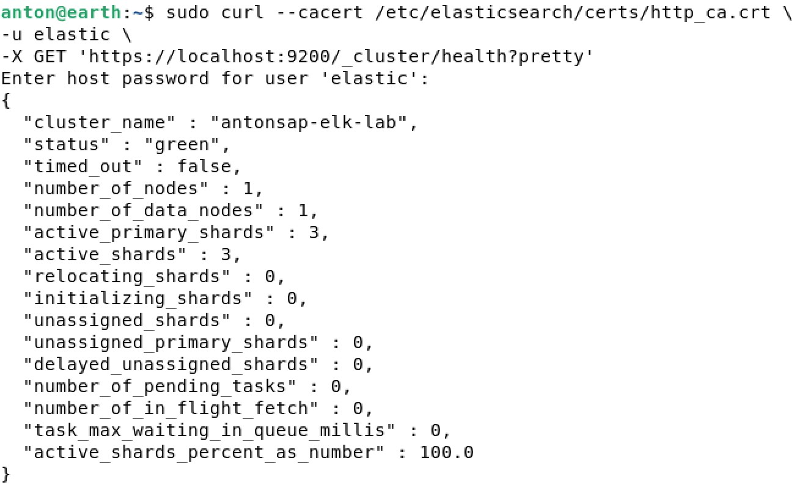
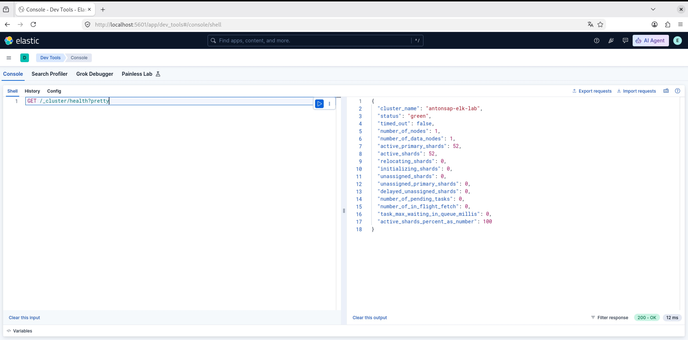
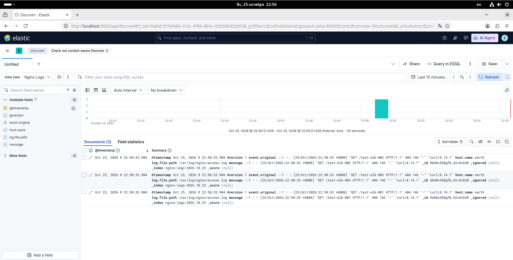
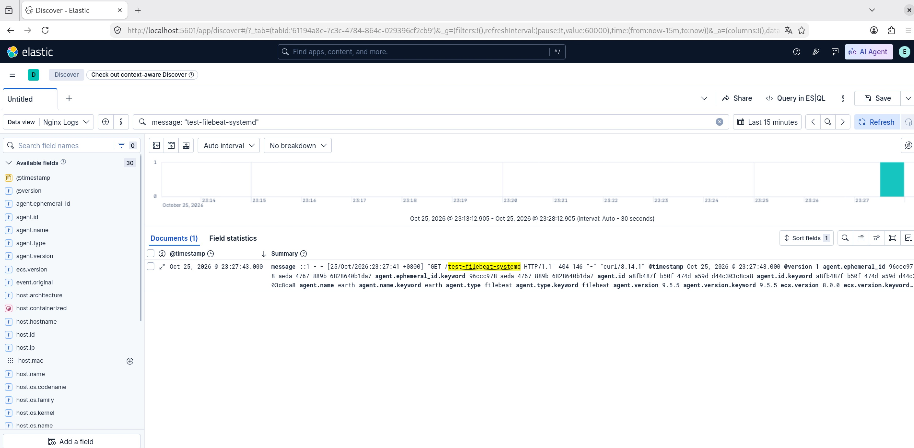

# Домашнее задание: ELK Stack

Антон Сап

## Задание 1. Elasticsearch

Установил Elasticsearch и проверил состояние кластера. Статус — **green**, ошибок нет.

## Задание 2. Kibana

Установил Kibana, подключил её к Elasticsearch и проверил работу через **Dev Tools**.

## Задание 3. Logstash

Установил Nginx и Logstash. Настроил чтение логов Nginx и отправку их в Elasticsearch. Проверил, что запросы к сайту отображаются в **Kibana Discover**.

## Задание 4. Filebeat

Установил Filebeat и настроил передачу логов по схеме:

**Nginx → Filebeat → Logstash → Elasticsearch → Kibana**

Отправил тестовые запросы к Nginx и убедился, что они появились в Kibana. Также настроил автоматический запуск служб через `systemd`.

## Итог

Все четыре задания выполнены. Логи Nginx собираются и отображаются в Kibana. 
